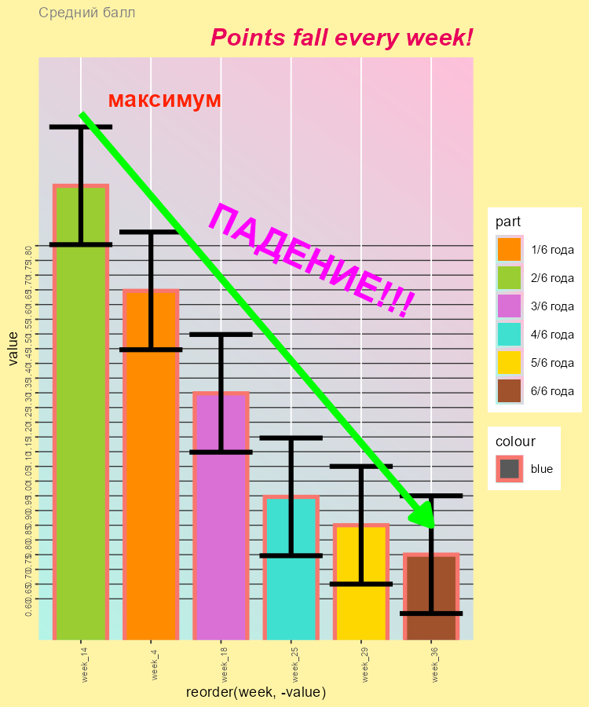
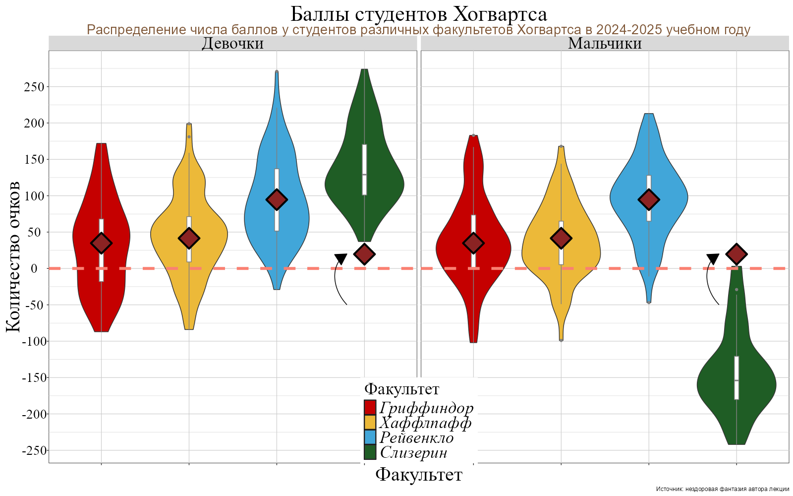

# Как выполнить и сдать

В домашнем задании вы продолжите работать с данными `hogwarts`. Этот файл лежит в папке задания вместе с данными (`data`) и картинками к заданиям (`images`); файл есть и в Google Классе. Решения пишите прямо здесь, в `homework_viz_2026.qmd`: под каждым заданием оставлен пустой чанк.

1.  Откройте папку задания в Positron (`File → Open Folder`). Проект — это и есть открытая папка, R работает из её корня.
2.  Файл задания лежит в корне этой папки, рядом с `data` и `images`. Если вы скачали его отдельно из Google Класса, положите его туда же.
3.  Все пути — относительные, от корня проекта: `data/hogwarts_2026.csv`, `images/task_2_4.png`. Путей вида `C:/Users/…` в работе быть не должно.
4.  Отрендерите файл в HTML: кнопкой Preview в Positron или в терминале командой `quarto render homework_viz_2026.qmd`. Рядом появится `homework_viz_2026.html`.
5.  Загрузите `.qmd` и `.html` на свой GitHub, в папку `basic_datavis_hw_2026`.
6.  Чтобы сдать задание, приложите ссылку на GitHub в Google Классе.

В этом задании почти соблюдаются принципы классицизма: одно задание — не меньше одного графика и не меньше одного чанка, если не сказано иное. Правило действует, даже когда задание просит вернуться к предыдущему графику. При этом вы всегда можете расширить интерпретацию или показать то же самое ещё и другим, более подходящим, на ваш взгляд, способом — дополнительными графиками к заданию. Некоторые пункты касаются того, о чём на занятиях прямо не говорили, и потребуют справки и документации; обычно такие места оговорены в условии явно.

Если возникнут трудности технического, коммуникативного или иного характера, пишите в общий чат в Telegram или в личные сообщения: [\@EvaMariaShelley](https://t.me/EvaMariaShelley) (Ева) и [\@dj_djenny](https://t.me/dj_djenny) (Диана).

# Правила для всех заданий

Выполняйте их, даже если в тексте задания они не упомянуты.

- Под каждым графиком напишите интерпретацию: что на нём видно и какой вывод из этого следует, в 2–4 предложениях. Перечисление геомов и цветов интерпретацией не считается. Если вывода нет или данных для него мало, так и напишите.
- Делайте текст на графике настолько крупным, насколько позволяют сам график и ваше чувство меры. Читаемые надписи — важный (но не так уж часто встречающийся) элемент графиков.
- Не используйте фон ggplot2 по умолчанию.
- У каждого графика должен быть заголовок, отражающий его суть, и правильно названные оси.
- Все подписи на графиках — на русском языке.
- Старайтесь, чтобы графики были достаточно крупными и читались не только в отрендеренном HTML, но и при интерактивном запуске чанков в Positron.
- Однотипные графики стройте функцией (конспект 2, раздел «П6 · Функция для однотипных графиков (слайд П6)»).
- Цвета факультетов — как в конспектах: Гриффиндор `#B32025`, Хаффлпафф `#D7A900`, Рейвенкло `#2E5EAA`, Слизерин `#2F7D4A`. В задании 10 цвета берите с образца.

Для некоторых заданий понадобится пакет patchwork: он собирает несколько графиков в один (конспект 2, раздел «П9 · Несколько графиков на одну страницу (слайд П9)»). Советуем почитать его документацию и пользоваться им в домашней работе. Для задания 8 нужен пакет gghighlight. Если каких-то пакетов нет, установите их один раз в консоли: `install.packages(c("patchwork", "gghighlight"))`.

Если, пока вы строите и интерпретируете график, у вас появилась гипотеза, не стесняйтесь её проверить: постройте для того же задания ещё один график (или несколько), проведите дополнительное исследование.

# Подготовка

```{r setup}
#| message: false

library(tidyverse)
library(patchwork)
library(gghighlight)

hogwarts <- read_csv("data/hogwarts_2026.csv", show_col_types = FALSE)
```

# Задание 1

Постройте барплот (столбчатую диаграмму), отражающий распределение числа студентов по курсам обучения. Раскрасьте столбики любым понравившимся цветом: подойдёт и название цвета, и hex-код. Задайте и цвет контура столбиков. Проинтерпретируйте график.

```{r task-1}

```

**Интерпретация:** …

# Задание 2

Постройте новый барплот, отражающий распределение числа студентов по факультетам. Добавьте на график вторую факторную переменную — происхождение (`bloodStatus`).

С помощью аргумента `position` измените график так, чтобы каждый столбец показывал распределение факультета по чистоте крови в долях. Запишите текстом в этом файле, какой вывод можно сделать из графика.

```{r task-2}

```

**Вывод:** …

# Задание 3

Отобразите распределение баллов, заработанных студентами на 3-й неделе обучения, по факультетам. Постарайтесь показать одновременно и форму распределения, и некоторые описательные статистики. Отсортируйте факультеты в порядке убывания медианного балла за 3-ю неделю (функция, которую мы разбирали на слайде 21, по умолчанию сортирует именно по медиане, так что задавать медиану отдельным аргументом не нужно). Если используете `geom_jitter()`, постарайтесь, чтобы точки лежали кучнее вдоль оси, которая не отражает само распределение. Проинтерпретируйте график.

```{r task-3}

```

**Интерпретация:** …

# Задание 4

Постройте гистограмму результатов любого экзамена на ваш выбор, кроме зельеварения. Настройте оптимальное, на ваш взгляд, число столбцов гистограммы. Выполните фасетирование по курсу. Постарайтесь, чтобы график был по возможности компактным. Проинтерпретируйте график.

```{r task-4}

```

**Интерпретация:** …

# Задание 5

Постройте скаттерплот, показывающий связь между суммарным баллом студента за год и оценкой за экзамен (по травологии, магловедению, нумерологии и зельеварению). Добавьте на график линию тренда. Удалите доверительную область и сделайте линию прямой. Подумайте, как обойтись без того, чтобы записывать одни и те же координаты x и y дважды. Проинтерпретируйте график.

Раскрасьте точки в разные цвета в соответствии с факультетами. Проинтерпретируйте полученный результат.

```{r task-5}

```

**Интерпретация:** …

# Задание 6

Сравните распределение баллов за экзамен по прорицанию и за экзамен по защите от тёмных искусств. Сделайте это тремя разными способами. Под разными способами понимаются идеологически разные геомы или способы группировки. Не считаются разными способами изменения константных визуальных параметров (цвет заливки, размер фигур, другие чисто стилевые отличия) на сходных в остальном графиках.

Объедините графики так, чтобы итоговый график имел два столбца и две строки. Два графика должны стоять в верхней строке и занимать равную площадь. Третий график должен занимать нижнюю строку целиком. Проинтерпретируйте график.

```{r task-6}

```

**Интерпретация:** …

# Задание 7

Постройте диаграмму рассеяния (скаттерплот), где по осям отложены результаты экзаменов по заклинаниям и по древним рунам. На графике есть некоторая проблема. Если вам трудно её определить, возьмите подсказку: постройте скаттерплот по данным из файла `data/podskazka.csv`. По оси x отложите переменную `y`, по оси y — переменную `x`, а пределы оси y задайте от 200 до 500. Предложите и подкрепите визуализациями не менее трёх способов решить эту проблему.

```{r task-7}

```

**Проблема и способы её решения:** …

# Задание 8

Используйте таблицу с баллами по неделям для первых 30 студентов, которую мы получили на занятии (`first_30`, конспект 2, раздел «Линии: `group`, спагетти, акцент, профиль (слайд 53)»). В ней пока нет столбца `bloodStatus`, а он понадобится для подписей. Постройте лайнплоты для всех студентов. Выделите при помощи пакета gghighlight студентов факультета Рейвенкло, на лейблах отразите их происхождение.

Линии студентов других факультетов покрасьте в нейтральный серый цвет и задайте его явно, а их толщину сделайте не больше трети стандартной. Проинтерпретируйте график.

```{r task-8}

```

**Интерпретация:** …

# Задание 9

Подробно (останавливаясь на каждом пункте, а не в общем) опишите, какие стороны графика и интерпретации (она приводится ниже) вы считаете верными и сделанными в соответствии с хорошими практиками, а какие — нет. Сделайте свой график, который отвечает на тот же исследовательский вопрос, но лишён технических и интерпретационных недостатков оригинала (если вы таковые нашли и упомянули).

График лежит в файле `images/task_2_4.png`:



Интерпретация графика:

> В ходе исследования, проведенного в ФГБОУССО «Хогвартс» (далее Хогвартс) для оценки успешности образовательного процесса и психоэмоционального состояния участников вышеназванного процесса, были выявлены тревожные закономерности. А именно — при оценке среднего балла, полученного в течение недели совокупностью учащихся Хогвартса, была выявлена тенденция к резкому снижению данного показателя с течением времени. Так, в начале учебного процесса студенты набирали в среднем 2 балла (максимальный показатель). В последующие недели балл достоверно снижался, достигая минимальных значений к концу года (см. рис. 1). Мы полагаем, что данный процесс связан с ухудшением психологического состояния преподавателей означенного учебного заведения. Таким образом, в течение года они от мотивирующих мер положительного характера (добавление баллов за правильные ответы на занятиях и успехи во внеучебной деятельности) переходят к репрессивным действиям (учащающийся и увеличивающийся по модулю отъем баллов факультета за предполагаемые нарушения дисциплины, недостаточную, по мнению преподавателя, подготовку к занятию и пр.). Это вызывает снижение у учащихся мотивации к получению знаний, что вызывает следующий шаг снижения средненедельного балла — т.о., поведение педагогов вызывает своего рода circulus vitiosus.
>
> По итогам исследования и с учетом полученных результатов предлагается следующее: произвести замену профессорско-преподавательского состава с заменой педагогов, наиболее подверженных выгоранию в течение года (проявляющемуся в виде систематического снижения баллов студентам). Издать декрет о недопущении избыточного штрафования учащихся, начиная с 18-й недели учебного процесса до конца года. К нарушителям применять взыскания материально-магического характера. Объявить выговор с занесением в личное дело текущим представителям руководящего состава Хогвартса (далее дирекция).

**Разбор графика и интерпретации:** …

```{r task-9}

```

# Задание 10 (дополнительное)

Воспроизведите график максимально близко к оригиналу и проинтерпретируйте его. Постарайтесь максимально точно отразить каждый элемент.

Образец лежит в файле `images/task_10.png`:



```{r task-10}

```

**Интерпретация:** …
